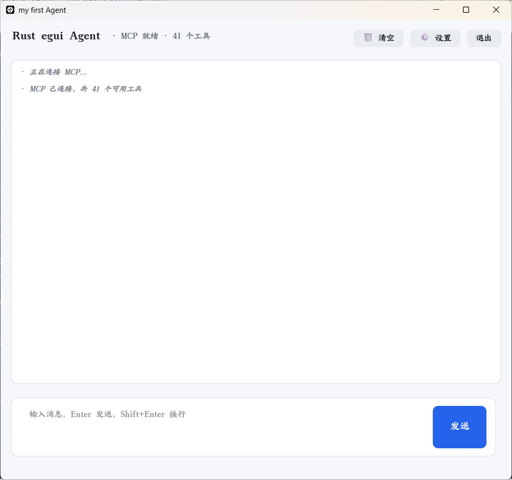
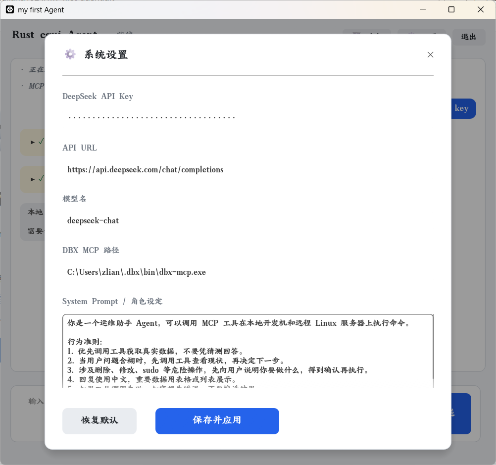
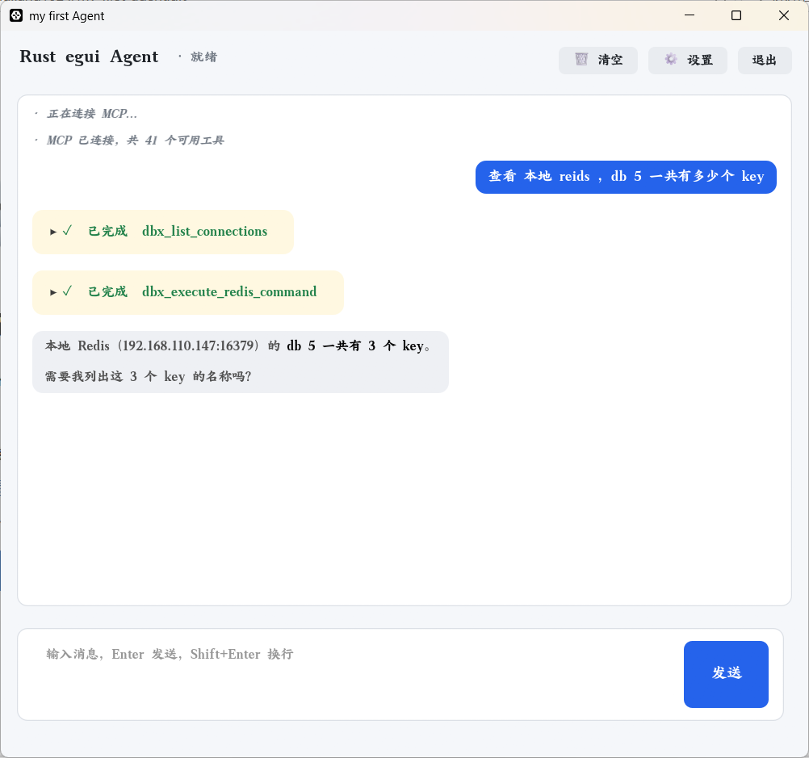

# 项目结构
```
src/
├── main.rs                 # 1. 极简入口
├── config.rs               # 2. 配置管理
├── storage/                # 3. 存储层
│   ├── mod.rs              #   定义 Storage Trait 和导出
│   └── json_store.rs       #   具体的本地 JSON 存储实现
├── llm/                    # 4. 模型层（以后加 openai.rs, claude.rs）
│   ├── mod.rs              #    定义通用数据结构
│   └── deepseek.rs         #    DeepSeek 的具体实现
├── agent/                  # 5. Agent 后台引擎层
│   ├── mod.rs              #    定义命令、事件枚举
│   └── loop_runner.rs      #    Agent 主循环
└── ui/                     # 6. 界面视图层
    ├── mod.rs
    ├── app.rs              #    AgentApp 状态与事件响应
    ├── style.rs            #    样式常量
    ├── components/         #    通用 UI 组件
    │   ├── mod.rs
    │   └── bubble.rs       #    气泡组件
    └── views/              #    具体页面视图
        ├── mod.rs
        ├── main_view.rs    #    主界面
        └── settings.rs     #    设置弹窗
```
# 使用说明
 ```
 git clone https://github.com/zliangliang1024/my_first_agent.git
 cargo run
 ```
 # 使用截图
 
 
 